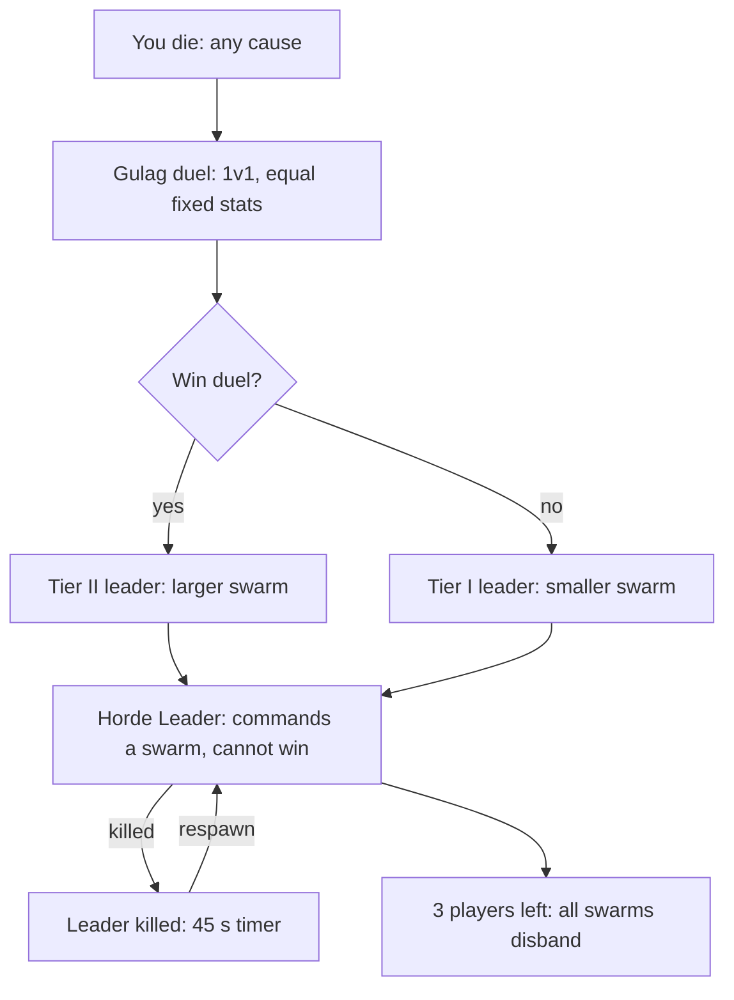

# Game Design Doc: Animal Battle Royale

Last updated: 2026-10-21

## Overview

A 20-player 3D animal battle royale where you level up by slaughtering animal hordes, then hunt each other while a lava ring closes in. Every player picks a real animal with skills drawn from what that animal does in nature. Dead players are never spectators: they pass through a Gulag and come back as the leader of a fodder swarm that harasses survivors but cannot win the match.

| Item | Decision |
| --- | --- |
| Genre | Battle royale with PvE leveling |
| Players | 20 per match, with solo, duo, trio and squad queues |
| Perspective | 3D, third person |
| World | Procedurally generated each match: water, forest, bushes, rock, lava |
| Match length | 10 to 12 minutes |
| Voice | Proximity chat for everyone |
| Platform | PC only |

**How it differs from deeeep.io**

- 3D terrain with cover, water and height instead of a 2D open field.
- Forced fights: lava ring, XP that favors player kills, and a hunted mark on the leaders.
- Death moves you into a new role instead of ending your match.
- Proximity voice creates alliances, bluffs and betrayals.

## Design pillars

Every feature gets checked against these five.

1. **Real animals, real strengths.** A skill exists because the animal does it in nature.
2. **Fodder feeds, players threaten.** Hordes are the leveling engine, but only other players can beat you.
3. **Nobody sits out.** Death changes your role, never ends your match.
4. **The map pushes you together.** Lava, the XP curve and the hunted mark make hiding a losing plan.
5. **Talk is a weapon.** Proximity chat turns every encounter into a negotiation, a bluff or a betrayal.

## Match flow

A match runs about 12 minutes in five phases, and the lava ring closes at fixed times so the pace never depends on player choices. All numbers are first-pass values to tune in playtests.

| Phase | Time | Lava ring | What happens |
| --- | --- | --- | --- |
| 1. Scatter | 0:00 to 1:30 | None | 20 players spawn spread apart at level 1 beside weak hordes. Farm, pick first stat points. |
| 2. Farm | 1:30 to 4:00 | Ring 1 starts closing at 3:00 (map to 70%) | Mid-tier hordes spawn toward the center. First player contact. |
| 3. Clash | 4:00 to 7:00 | Ring 2 (map to 40%) | Alpha creature spawns in the center. First deaths open the Gulag. Top 3 levels get the hunted mark. |
| 4. Cull | 7:00 to 10:00 | Ring 3 (map to 20%) | Most players are dead and leading swarms. Ring speeds up, survivors are cornered. |
| 5. Final | 10:00 to 12:00 | Ring 4 (small island) | When 3 players remain, every swarm disbands for a clean final fight. |

## Core loop

You hunt horde animals for XP, level up, spend stat points and unlock skills, then use that power to fight players for bigger rewards. Horde animals scale in four tiers and give less XP the more you outlevel them.

| Tier | Role | Examples | Behavior |
| --- | --- | --- | --- |
| 1 Fodder | Early XP | Mice, sparrows, minnows, beetles | Flee or swarm, die in one or two hits |
| 2 Pack | Mid XP | Rabbits, ducks, foxes, perch | Fight in groups of 3 to 6 |
| 3 Elite | Big XP and food drops | Boar, heron, large pike | Strong single targets, drop healing meat |
| 4 Alpha | Jackpot XP | Alpha bear, giant gator | One per match in the center, draws players together |

Levels run 1 to 20. Each level gives one stat point to spend on Health, Attack, Speed, Stamina or Senses. Skills unlock at levels 3, 7, 12 and 18, with two branches to pick from at each unlock.

XP needed for level $L$ (starting curve):

$$XP_{need}(L) = 60 \cdot L^{1.35}$$

## Harvesting and inventory

Food, water and loot turn the map into a supply puzzle, and a small inventory stops anyone from hoarding. All numbers here are first drafts to test.

**Harvestables**

| Item | Source | Effect | Limit |
| --- | --- | --- | --- |
| Meat | Horde kills, with bigger drops from tier 3 elites | Heals over time, and is the main food for leaders | Spoils while carried |
| Berries and fruit | Bushes and fruit trees | Small heal and stamina | Stacks to 3 per slot |
| Roots and herbs | Forest and wetlands | Cure bleed, short buffs | One use each |
| Water pouch | Fill at lakes and the watering hole | Restores stamina fast | One slot, 2 sips, refills only at water |

**Item abilities.** Some items unlock a one-use ability for any animal, separate from level skills. Only one item ability can be active at a time.

| Item | Source | Ability |
| --- | --- | --- |
| Mud | Wetland banks | Wallow to take less lava damage for a short time |
| Honeycomb | Hives in trees | Throw to draw nearby hordes to a spot, or eat to heal |
| Feather bundle | Bird hordes | Short glide off cliffs and across narrow lava gaps |
| Tusk fragment | Boar and alpha drops | Your next hits cause bleed |
| Musk gland | Alpha drops | Hides your scent trail and pauses the hunted mark briefly |
| Reeds | Water edges | Breathe through a reed to stay hidden underwater |

**Inventory rules**

- Draft size is 6 slots for every animal. Most items do not stack.
- Dying drops your whole inventory as a loot pile, and leaders can eat it.
- Harvesting and eating take a few seconds and make noise, so they draw hordes.
- Meat spoils, so food is meant to be used soon, not saved.

## Animals and skills

Eight land and water animals ship at launch, balanced by role and size class rather than by raw stats. Every animal gets the same 100 base stat points to distribute, and its size class sets the trade-off. Flying animals wait until after v1 so the lava rules stay simple.

| Size class | Hitbox | Advantage | Cost |
| --- | --- | --- | --- |
| Small | Tiny | Stealth, dodging, fits through brush | Low health, short reach |
| Medium | Standard | Balanced speed and damage | No strong specialty |
| Large | Big | High health and damage, intimidates small hordes | Slow turns, loud footsteps, easy to hit |

| Animal | Class | Role | Signature skills | Weakness |
| --- | --- | --- | --- | --- |
| Wolf | Medium | Tracker | Howl marks enemies within 40 m for 5 s, lunge | Weak defense when alone |
| Bear | Large | Bruiser | Maul, Roar that scares small hordes | Slow, loud, big target |
| Cheetah | Medium | Assassin | 3 s burst sprint, pounce | Tires fast, low health |
| Honey Badger | Small | Brawler | Thick Hide damage resistance, Frenzy under 30% health | Short reach |
| Crocodile | Large | Ambusher | Submerge, Death Roll grapple in water | Slow on land |
| Wild Boar | Medium | Charger | Knockback charge, tusk gore that bleeds | Turns poorly |
| Otter | Small | Skirmisher | Fast swim, rock throw, slippery dodge | Fragile |
| Porcupine | Small | Counter-fighter | Quill Coat reflects damage, quill shot | Low mobility and damage |

Each animal has one passive and a pool of actives. The level 3, 7, 12 and 18 unlocks offer a choice of two, so two players on the same animal can build differently.

## Forced engagement

Avoiding other players has to be a losing strategy, so five systems push survivors into each other.

1. **Lava ring.** Lava deals 5% of max health per second in Ring 1 and rises each ring. Each closing is announced 30 seconds ahead with sound and visuals.
2. **XP that favors player kills.** Horde XP fades as you outlevel a tier, while a player kill pays a large bonus.
3. **Hunted mark.** The top 3 levels leave a scent trail, and the leader lets out a roar that reveals their position every 45 seconds.
4. **Contested healing.** Real healing comes from player-kill drops and watering holes in hot zones. Horde meat heals only a little.
5. **Migration event.** At 5:00 the hordes stampede toward the center, pushing everyone inward.

Horde XP for a creature of tier $T$ when you are level $L$:

$$XP_{horde} = XP_{base} \cdot \max\left(0.2,\ 1 - 0.06\,(L - L_{T})\right)$$

Player kill XP, with a catch-up bonus when the victim out-levels you:

$$XP_{kill} = \left(150 + 0.5 \cdot XP_{victim}\right) \cdot \min\left(2,\ 1 + 0.1\,(L_{victim} - L_{you})\right)$$

Fighting is also loud. Combat noise draws nearby hordes, so a long duel invites a third-party swarm.

## Squad queues

Players queue solo, duo, trio or squad, and every team fights everyone else in the same 20-player match. These are draft rules to test in Phase 2.

- **Hunted mark:** applies to the highest-level player on a team, not to every member.
- **Proximity chat:** teammates hear each other at normal proximity range, so splitting up has a cost. A team channel is a test option.
- **Kill XP:** the bonus goes to the killer, with a smaller share to nearby teammates.
- **Queues:** match solos with solos where possible, since a full squad has a large advantage.

## Gulag and Horde Leader system

Every death sends you to the Gulag and then back as a Horde Leader, so nobody spectates. Leaders hurt survivors but cannot win or snowball.

The Gulag decides how big your swarm is, not whether you play.

**Gulag duel (placeholder).** Dead players fight 1v1 in a small arena at equal fixed stats. If nobody else is waiting, you fight the Warden, a tough horde alpha. For now, a win starts you as a Tier II leader and a loss as Tier I. The final Gulag format is still to be decided.

**Swarm type.** You choose between the two swarms native to the biome where you died. Forest and grassland offer Rat King or Bird Swarm. Wetlands offer Shoal Master or Bird Swarm.

**What a leader can do**

- Command the swarm to attack a target, scatter, or guard a position.
- Use one signature skill: Rat King's Plague Bite (damage over time), Bird Swarm's Dive Bomb (blinds), Shoal Master's Undertow (slows in water).
- Eat food and carcasses to grow stronger and rise to Tier III with one extra skill. Leaders cannot revive as players, so eating is how they get stronger.

**Limits that stop leaders from deciding the match**

| Rule | Value |
| --- | --- |
| Swarm budget | 60 animals shared by all leaders, minimum 3 each. More deaths means smaller swarms, not more pressure. |
| Tier share | Tier I gets 1x of the budget, Tier II 1.5x, Tier III 2x. |
| Damage cap | One swarm deals at most 30% of a player's max health per 10 seconds. |
| Fragile leader | Low health. If killed, you respawn after 45 seconds and keep your tier. |
| Lava applies | Swarm animals and leaders take lava damage like everyone else. |
| No ghosting | Leaders only see and hear what is near them, and Gulag chat is separate from the match. |
| Cannot win | Swarms disband when 3 players remain. Leaders earn account XP for damage and assists, so being dead still pays. |

## Proximity chat

Voice is spatial and local, so you only talk to animals you could also bite. The rules below keep it fun without letting dead players spy for the living.

| Rule | Value |
| --- | --- |
| Range | Full volume within 10 m, fading to silence at 40 m |
| Occlusion | Voices muffle behind rocks and trees and underwater |
| Crouching | Halves your voice range, so you can whisper |
| Leaders | Voice is distorted and limited to 15 m, enough to taunt and negotiate |
| Gulag | Separate voice channel for dead players only, no leak to the match |
| Controls | Push to talk by default, per-player mute and block, report with the last 30 s of audio |

Voice recording for reports needs a consent and privacy review before launch.

## World and terrain

Each match generates a new 3D map from a server-chosen seed, about 700 m by 700 m, so no two matches share a layout. Four biomes blend together and each shapes which animals and tactics work.

| Biome | Terrain | Cover | Horde | Favors |
| --- | --- | --- | --- | --- |
| Forest | Dense trees, uneven ground | Heavy | Rats, foxes | Small and stealth animals |
| Wetlands | Lakes, rivers, reeds | Medium | Fish, ducks | Otter, Crocodile |
| Grassland | Open plains, long grass | Light | Rabbits, birds | Cheetah, Wolf |
| Highlands | Rock, cliffs, vantage points | Medium | Goats, boars | Bear, Boar |

The center holds the watering hole and the Alpha den. Lava spreads from the map edge inward, replacing terrain as each ring closes.

**Terrain rules**

- Bushes hide you from view, trees block line of sight, and long grass slows you down.
- Shallow water slows land animals, and deep water needs swimming. Water animals gain speed and stealth there.
- Spawn points sit at least 120 m apart, and every ring contains at least one water body and one height advantage.
- The generator guarantees one connected landmass and places resources by Poisson disk sampling.

## Balance guardrails

Each known failure mode of this genre has a built-in guardrail and a number to tune in playtests.

| Risk | Guardrail | Tuning knob |
| --- | --- | --- |
| Players avoid each other and farm hordes | Horde XP fades as you outlevel a tier, player kills pay a large bonus | Fade of 0.06 per level |
| Level leader snowballs | Hunted mark on the top 3, catch-up bonus for killing higher levels | Roar every 45 s, bonus cap 2x |
| Death spiral from many leaders | Fixed 60-animal swarm budget, 30% damage cap, swarms disband at 3 players | Budget and damage cap |
| Campers | Standing still leaves a scent trail swarms can follow, and combat noise draws hordes | Stationary timer of 30 s |
| Size imbalance | Equal 100-point stat budget and size-class trade-offs | Per-animal stat split |
| Voice ghosting | Short ranges, leaders limited to 15 m, separate Gulag channel | Range values |

## Technical notes

Use a server-authoritative design with dedicated servers, because 20 players plus hundreds of horde animals cannot be trusted to clients.

- **Engine:** Unity with C# is the safe pick. Godot works for a fast prototype, since GDScript reads like Python. Unreal fits if visuals come first.
- **Networking:** a netcode library such as Photon Fusion or Netcode for GameObjects, with interest management so each client only receives nearby entities.
- **Procedural maps:** the server picks a 64-bit seed and clients rebuild the terrain from noise, so the map never travels over the network. The lava ring is a server-driven radius.
- **Horde AI:** simple state machines with flocking, simulated in detail only near players. Start with a budget of about 300 active animals and tune from profiling.
- **Voice:** a 3D positional voice SDK such as Vivox, Photon Voice or Agora, with the Gulag as its own channel.
- **Rendering:** GPU instancing for swarms, so large swarms stay cheap to draw.

## MVP scope and roadmap

Build the fun first and the fairness second: prove the farming loop alone, then add players, then the Gulag. Each phase has a gate that must pass before the next starts.

| Phase | Scope | Exit gate |
| --- | --- | --- |
| 1. Greybox solo | Terrain generator, 1 animal, tier 1 and 2 hordes, XP and levels, no network | Farming for 3 minutes is fun on its own |
| 2. Multiplayer slice | 4 to 6 players, 3 animals, lava ring, player kill XP | Players seek each other out instead of farming |
| 3. Full loop | 20 players, Gulag, Horde Leaders, proximity voice, all 8 animals | A match finishes in about 12 minutes with no death spiral |
| 4. Playtest and balance | Tune XP, swarm budget and animals, add voice moderation tools | No animal dominates win rate over about 50 test matches |

## Open questions and risks

These decisions change the design the most, so settle them before Phase 2.

- [x] Platform: PC only
- [x] Squads: solo, duo, trio and squad queues
- [x] Leaders cannot revive, and grow stronger by eating
- [x] Art style: defined in a separate document
- [x] Monetization: none
- [ ] Gulag format: still to be decided
- [ ] Squad size cap, friendly fire, and whether living teammates can revive each other
- [ ] Can a dead player's leader swarm defend their former squad?
- [ ] Win condition with squads: last team standing, and when swarms disband
- [ ] What leaders can eat, and how fast eating raises their tier
- [ ] Do living players have hunger and thirst meters, or is food only healing and buffs?
- [ ] Inventory size: the same for every animal, or smaller for small animals?
- [ ] Which item abilities ship in v1?
- [ ] Flying animals after v1, and how they interact with lava

**Top risks**

- Hordes feel too rewarding, so players farm and never fight.
- Swarm and horde simulation costs more server time than expected.
- Voice moderation and recording consent add legal work.
- Random maps sometimes produce unfair spawns.
